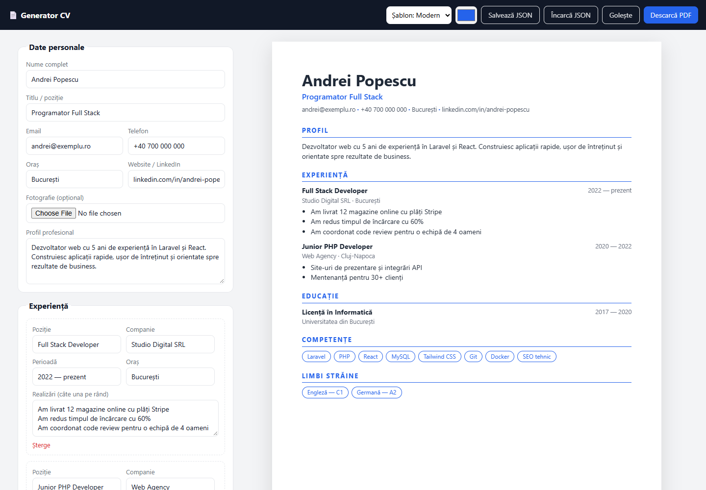

<h1 align="center">📄 Generator CV</h1>

<p align="center">Creezi un CV profesional direct în browser: completezi, vezi live pe o foaie A4 și îl descarci PDF.<br><b>Datele nu pleacă de pe calculatorul tău.</b></p>

<p align="center">
<a href="https://gabrieldevro.github.io/cv-builder/"></a>


</p>

<p align="center"></p>

---

## Funcționalități

- **Previzualizare live pe A4** (210 × 297 mm), exact ce iese la tipărire
- **Export PDF** prin dialogul de tipărire al browserului: text selectabil, fără watermark
- **2 șabloane**, Modern și Clasic, plus o **culoare de accent** la alegere
- Secțiuni pentru experiență și educație, pe care le adaugi sau le ștergi oricând
- **Fotografie opțională**, micșorată automat la 400 px
- **Salvare automată** în browser (localStorage) și **export sau import JSON**, ca să muți CV-ul pe alt calculator
- Interfață în română, responsive pe telefon
- **Confidențialitate:** zero servere, zero tracking, zero cont

## Rulare

Nu are nevoie de instalare sau build. Deschide `index.html` în browser sau:

```bash
git clone https://github.com/Gabrieldevro/cv-builder.git
cd cv-builder
npx serve .        # sau orice server static
```

## Cum funcționează

```text
index.html   formularul și template-urile pentru experiență/educație
app.js       starea CV-ului → previzualizare (escapare HTML, salvare locală, import/export)
style.css    editorul, foaia A4 și regulile @media print pentru PDF
```

Totul pornește dintr-un singur obiect `state`. Fiecare modificare din formular îl actualizează, redesenează foaia A4 și îl salvează local. La PDF, `@page { size: A4; margin: 0 }` și `@media print` ascund editorul și păstrează doar foaia.

---

<p align="center">Făcut de <a href="https://gabrieldev.eu"><b>Gabriel Dev</b></a>. O variantă extinsă rulează pe <a href="https://inonline.ro">inonline.ro</a>.<br>
Ai nevoie de un tool web pentru afacerea ta? <a href="https://gabrieldev.eu/contact">Scrie-mi</a>.</p>
